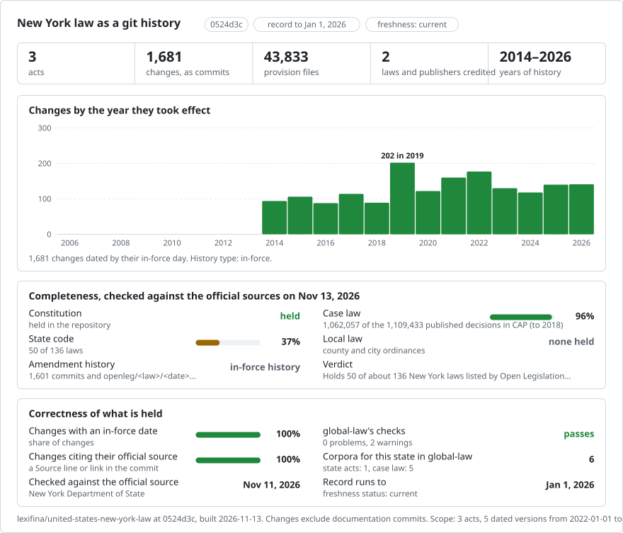

# United States (New York): law history in git

<picture>
<source media="(prefers-color-scheme: dark)" srcset="data/effort-dark.svg">

</picture>

Official New York law texts published by the New York State Senate through Open Legislation.

This record contains 136 law folders. 85 laws added in this append have one current official publication snapshot each; their earlier publication history remains to be added. The official API lists 137 entries.

| Law ID | Official title | Folder | Publication snapshots |
| --- | --- | --- | ---: |
| ABC | Alcoholic Beverage Control | `law-abc/` | 122 |
| ABP | Abandoned Property | `law-abp/` | 11 |
| ACA | Arts and Cultural Affairs | `law-aca/` | 31 |
| ACG | Alternative County Government | `law-acg/` | 2 |
| AGM | Agriculture & Markets | `law-agm/` | 129 |
| BAT | Bridges and Tunnels New York/New Jersey 47/31 | `law-bat/` | 1 |
| BNK | Banking | `law-bnk/` | 83 |
| BSW | Boxing, Sparring and Wrestling Ch. 912/20 | `law-bsw/` | 6 |
| BVO | Benevolent Orders | `law-bvo/` | 3 |
| CAL | Canal | `law-cal/` | 14 |
| CAN | Cannabis | `law-can/` | 23 |
| CCA | New York City Civil Court | `law-cca/` | 27 |
| CCO | Cooperative Corporations | `law-cco/` | 3 |
| CCT | Cigarettes, Cigars, Tobacco 235/52 | `law-cct/` | 2 |
| CMA | Assembly Rules | `law-cma/` | 14 |
| CMS | Senate Rules | `law-cms/` | 9 |
| CNT | County | `law-cnt/` | 55 |
| COM | Economic Development Law | `law-com/` | 66 |
| COR | Correction | `law-cor/` | 135 |
| CPL | Criminal Procedure | `criminal-procedure-law/` | 1 |
| CRC | New York City Criminal Court Act | `law-crc/` | 13 |
| CTC | Court of Claims | `law-ctc/` | 15 |
| CVP | Civil Practice Law & Rules | `civil-practice-law-and-rules/` | 121 |
| CVR | Civil Rights | `civil-rights-law/` | 51 |
| CVS | Civil Service | `civil-service-law/` | 96 |
| DCD | Debtor & Creditor | `law-dcd/` | 8 |
| DEA | Defense Emergency Act 1951 784/51 | `law-dea/` | 6 |
| DOM | Domestic Relations | `domestic-relations-law/` | 67 |
| DPN | Development of Port of New York 43/22 | `law-dpn/` | 1 |
| EDN | Education | `education-law/` | 1 |
| EDP | Eminent Domain Procedure | `law-edp/` | 3 |
| EHC | Expanded Health Care Coverage Act 703/88 | `law-ehc/` | 1 |
| ELD | Elder | `law-eld/` | 55 |
| ELN | Election | `law-eln/` | 1 |
| EML | Employers' Liability | `law-eml/` | 2 |
| ENG | Energy | `law-eng/` | 14 |
| ENV | Environmental Conservation | `law-env/` | 1 |
| EPT | Estates, Powers & Trusts | `estates-powers-and-trusts-law/` | 25 |
| ERL | Emergency Housing Rent Control Law 274/46 337/61 | `law-erl/` | 9 |
| ETP | Emergency Tenant Protection Act 576/74 | `law-etp/` | 13 |
| EXC | Executive | `executive-law/` | 1 |
| FCT | Family Court Act | `law-fct/` | 120 |
| FDC | Facilities Development Corporation Act 359/68 | `law-fdc/` | 9 |
| FEA | NYS Financial Emergency Act for the city of NY 868/75 | `law-fea/` | 13 |
| FIS | Financial Services Law | `law-fis/` | 27 |
| GAS | General Associations | `law-gas/` | 5 |
| GBS | General Business | `law-gbs/` | 1 |
| GCM | General City Model 772/66 | `law-gcm/` | 3 |
| GCN | General Construction | `law-gcn/` | 11 |
| GCT | General City | `law-gct/` | 30 |
| GMU | General Municipal | `general-municipal-law/` | 1 |
| GOB | General Obligations | `general-obligations-law/` | 36 |
| HAY | Highway | `law-hay/` | 90 |
| HHC | New York City health and hospitals corporation act 1016/69 | `law-hhc/` | 3 |
| IND | Indian | `law-ind/` | 8 |
| ISC | Insurance | `insurance-law/` | 1 |
| JUD | Judiciary | `law-jud/` | 1 |
| LAB | Labor | `labor-law/` | 1 |
| LEG | Legislative | `law-leg/` | 1 |
| LEH | Local Emergency Housing Rent Control Act 21/62 | `law-leh/` | 1 |
| LFN | Local Finance | `law-lfn/` | 1 |
| LIE | Lien | `law-lie/` | 1 |
| LSA | Lost and Strayed Animals 115/1894 | `law-lsa/` | 1 |
| MCF | Medical Care Facilities Finance Agency 392/73 | `law-mcf/` | 1 |
| MDW | Multiple Dwelling | `law-mdw/` | 1 |
| MHA | Municipal Housing Authorities | `law-mha/` | 1 |
| MHR | Municipal Home Rule | `law-mhr/` | 1 |
| MHY | Mental Hygiene | `law-mhy/` | 1 |
| MIL | Military | `law-mil/` | 1 |
| MRE | Multiple Residence | `law-mre/` | 1 |
| NAV | Navigation | `law-nav/` | 1 |
| NNY | New, New York Bond Act 649/92 | `law-nny/` | 1 |
| NPC | Not-for-Profit Corporation | `law-npc/` | 1 |
| NYP | NYS Project Finance Agency Act7/75 | `law-nyp/` | 1 |
| NYW | N. Y. wine/grape 80/85 | `law-nyw/` | 1 |
| PAB | Private Activity Bond 47/90 | `law-pab/` | 1 |
| PAR | Parks, Recreation and Historic Preservation | `law-par/` | 1 |
| PBA | Public Authorities | `law-pba/` | 1 |
| PBB | Public Buildings | `law-pbb/` | 1 |
| PBG | Public Housing | `law-pbg/` | 1 |
| PBH | Public Health | `public-health-law/` | 1 |
| PBL | Public Lands | `law-pbl/` | 1 |
| PBO | Public Officers | `law-pbo/` | 1 |
| PBS | Public Service | `law-pbs/` | 1 |
| PCM | Police Certain Municipalities 360/11 | `law-pcm/` | 1 |
| PEN | Penal | `penal-law/` | 1 |
| PEP | Personal Property | `law-pep/` | 1 |
| PML | Racing, Pari-Mutuel Wagering and Breeding Law | `law-pml/` | 1 |
| PNY | Port of New York Authority 154/21 | `law-pny/` | 1 |
| POA | Port of Albany 192/25 | `law-poa/` | 1 |
| PPD | New York State Printing and Public Documents | `law-ppd/` | 1 |
| PTR | Partnership | `law-ptr/` | 1 |
| PVH | Private Housing Finance | `law-pvh/` | 1 |
| RAT | Rapid Transit | `law-rat/` | 1 |
| RCO | Religious Corporations | `law-rco/` | 1 |
| REL | Rural Electric Cooperative | `law-rel/` | 1 |
| RLA | Regulation of Lobbying Act 1040/81 | `law-rla/` | 1 |
| RPA | Real Property Actions & Proceedings | `law-rpa/` | 1 |
| RPP | Real Property | `real-property-law/` | 1 |
| RPT | Real Property Tax | `law-rpt/` | 1 |
| RRD | Railroad | `law-rrd/` | 1 |
| RSS | Retirement & Social Security | `law-rss/` | 1 |
| SAP | State Administrative Procedure Act | `law-sap/` | 1 |
| SCC | Second Class Cities | `law-scc/` | 1 |
| SCP | Surrogate's Court Procedure | `law-scp/` | 1 |
| SCT | Suffolk County Tax Act | `law-sct/` | 1 |
| SLG | Statute of Local Governments | `law-slg/` | 1 |
| SNH | Special Needs Housing Act 261/88 | `law-snh/` | 1 |
| STF | State Finance | `law-stf/` | 1 |
| STL | State | `law-stl/` | 1 |
| STT | State Technology | `law-stt/` | 1 |
| SWC | Soil & Water Conservation Districts | `law-swc/` | 1 |
| TAX | Tax | `tax-law/` | 1 |
| TCP | Transportation Corporations | `law-tcp/` | 1 |
| TRA | Transportation | `law-tra/` | 1 |
| TRY | City of Troy Issuance of Serial Bonds | `law-try/` | 1 |
| TSF | Tobacco Settlement Financing Corporation Act | `law-tsf/` | 1 |
| TWN | Town | `law-twn/` | 1 |
| UCC | Uniform Commercial Code | `law-ucc/` | 1 |
| UCT | Uniform City Court Act | `law-uct/` | 1 |
| UDA | Urban Development Corporation Act 174/68 | `law-uda/` | 1 |
| UDC | Uniform District Court Act | `law-udc/` | 1 |
| UDG | Urban development guarantee fund of New York 175/68 | `law-udg/` | 1 |
| UDR | Urban development research corporation act 173/68 | `law-udr/` | 1 |
| UJC | Uniform Justice Court Act | `law-ujc/` | 1 |
| VAT | Vehicle & Traffic | `vehicle-and-traffic-law/` | 1 |
| VAW | Volunteer Ambulance Workers' Benefit | `law-vaw/` | 1 |
| VET | Veterans' Services | `law-vet/` | 1 |
| VIL | Village | `law-vil/` | 1 |
| VOL | Volunteer Firefighters' Benefit | `law-vol/` | 1 |
| WKC | Workers' Compensation | `law-wkc/` | 1 |
| YFA | Yonkers financial emergency act 103/84 | `law-yfa/` | 1 |
| YTS | Yonkers income tax surcharge | `law-yts/` | 1 |
| — | New York Business Corporation Law | `business-corporation-law/` | 1 |
| — | Constitution of the State of New York | `constitution/` | 3 |
| — | New York Limited Liability Company Law | `limited-liability-company-law/` | 1 |

Publication snapshot dates come from the Senate API publishedDates and lawVersion.activeDate fields. They do not establish exact legal commencement. Earlier wording is included only where an earlier snapshot is recorded. The three pre-API law folders retain their published representation.

Text-bearing structural documents are retained with sections. Publisher: New York State Senate. Government edicts are not copyrightable; Georgia v. Public.Resource.Org, Inc., 590 U.S. 255 (2020).

Use `python tools/on.py YYYY-MM-DD <folder>` to read a publication snapshot.
